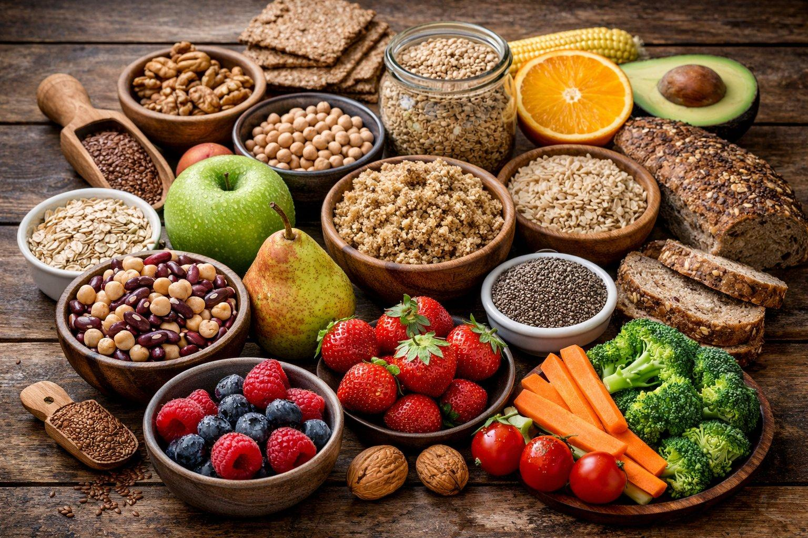

# Diabetes Mellitus

## 1. O que é?

O diabetes mellitus é uma doença caracterizada pelo aumento dos níveis de glicose (açúcar) no sangue. Isso acontece quando o organismo não produz insulina suficiente ou não consegue utilizá-la adequadamente.

A insulina é um hormônio responsável por ajudar a glicose a entrar nas células, onde será utilizada como fonte de energia.

Existem diferentes tipos de diabetes, sendo os principais:

- **Diabetes tipo 1:** ocorre quando o sistema imunológico ataca as células responsáveis pela produção de insulina.
- **Diabetes tipo 2:** ocorre quando o organismo apresenta resistência à insulina e/ou não produz insulina suficiente.
- **Diabetes gestacional:** é identificado durante a gestação e exige acompanhamento específico.

## 2. Alimentos que exigem atenção

Alguns alimentos podem contribuir para o aumento da glicose no sangue, principalmente quando consumidos em grandes quantidades ou com frequência.

### Bebidas e alimentos açucarados
- Refrigerantes comuns.
- Sucos industrializados com açúcar adicionado.
- Bebidas adoçadas.
- Doces e sobremesas.
- Balas e chocolates açucarados.
- Biscoitos recheados.

### Alimentos ricos em carboidratos refinados
- Pães feitos com farinha refinada.
- Bolos e massas refinadas.
- Cereais açucarados.
- Produtos de panificação com açúcar adicionado.

**Atenção:** alimentos ricos em carboidratos não são necessariamente proibidos. A quantidade, o tipo de alimento e a composição da refeição influenciam a resposta da glicose no sangue.

## 3. Alimentos geralmente recomendados

Uma alimentação equilibrada, com preferência por alimentos naturais ou minimamente processados, pode auxiliar no controle glicêmico.

### Verduras e legumes
- Alface.
- Couve.
- Brócolis.
- Cenoura.
- Abobrinha.
- Pepino.

### Frutas
- Maçã.
- Pera.
- Laranja.
- Morango.
- Mamão.
- Abacate.

### Cereais e leguminosas
- Aveia.
- Arroz integral.
- Feijão.
- Lentilha.
- Grão-de-bico.

### Fontes de proteínas
- Ovos.
- Peixes.
- Frango.
- Carnes magras.

**Importante:** frutas, arroz, feijão e outros alimentos que contêm carboidratos podem fazer parte da alimentação de pessoas com diabetes. A quantidade e a distribuição devem considerar as necessidades individuais.

## 4. Cuidados alimentares

- Priorizar alimentos in natura e minimamente processados.
- Reduzir o consumo frequente de bebidas açucaradas.
- Preferir alimentos ricos em fibras.
- Observar a quantidade de carboidratos consumida nas refeições.
- Evitar substituir refeições por produtos sem orientação profissional.
- Manter acompanhamento médico e nutricional.

## 5. O que não deve ser considerado uma proibição absoluta?

Nem todas as pessoas com diabetes precisam eliminar completamente o açúcar, as frutas, os pães ou outros alimentos que contêm carboidratos.

O planejamento alimentar deve considerar o tipo de diabetes, o tratamento, a rotina e as necessidades individuais.

A restrição alimentar sem orientação profissional pode prejudicar a qualidade da alimentação e o tratamento.

## 6. Fontes de pesquisa

**1. Sociedade Brasileira de Diabetes (SBD)**

Diretriz de Terapia Nutricional no Pré-Diabetes e Diabetes Mellitus Tipo 2 – Edição 2026.

https://diretriz.diabetes.org.br/terapia-nutricional-no-pre-diabetes-e-no-diabetes-mellitus-tipo-2/

**2. Sociedade Brasileira de Diabetes (SBD)**

Diretriz de Terapia Nutricional no Diabetes Tipo 1 – Edição 2026.

https://diretriz.diabetes.org.br/terapia-nutricional-no-diabetes-tipo-1/

**3. Ministério da Saúde**

Alimentação adequada e saudável para pessoas com Diabetes Mellitus.

https://www.gov.br/saude/pt-br/composicao/saps/ecv/publicacoes/orientacoes-nutricionais-para-a-pessoa-com-diabetes-mellitus

## 7. Observação

Este conteúdo possui finalidade educativa e informativa. Não substitui avaliação médica, acompanhamento nutricional ou prescrição individualizada.

As orientações alimentares podem variar conforme o tipo de diabetes, o tratamento e as condições de saúde de cada pessoa.

---

**Projeto Eita, Pode?**

Sua saúde tem suas regras. A informação facilita!