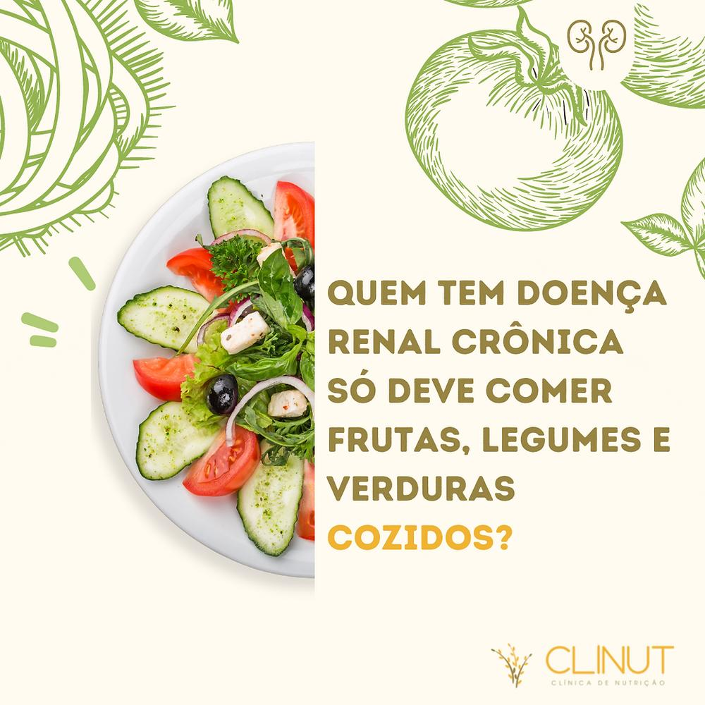
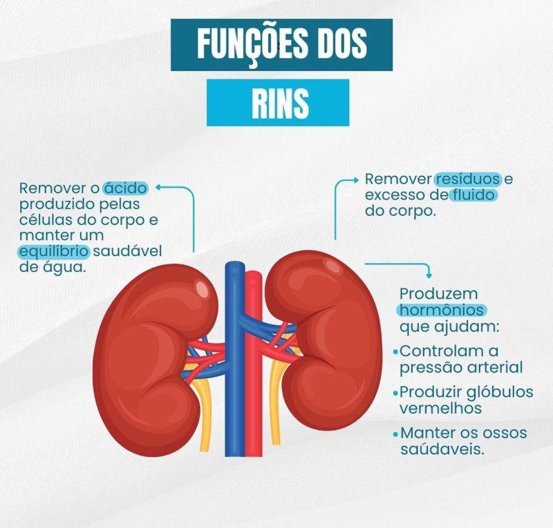
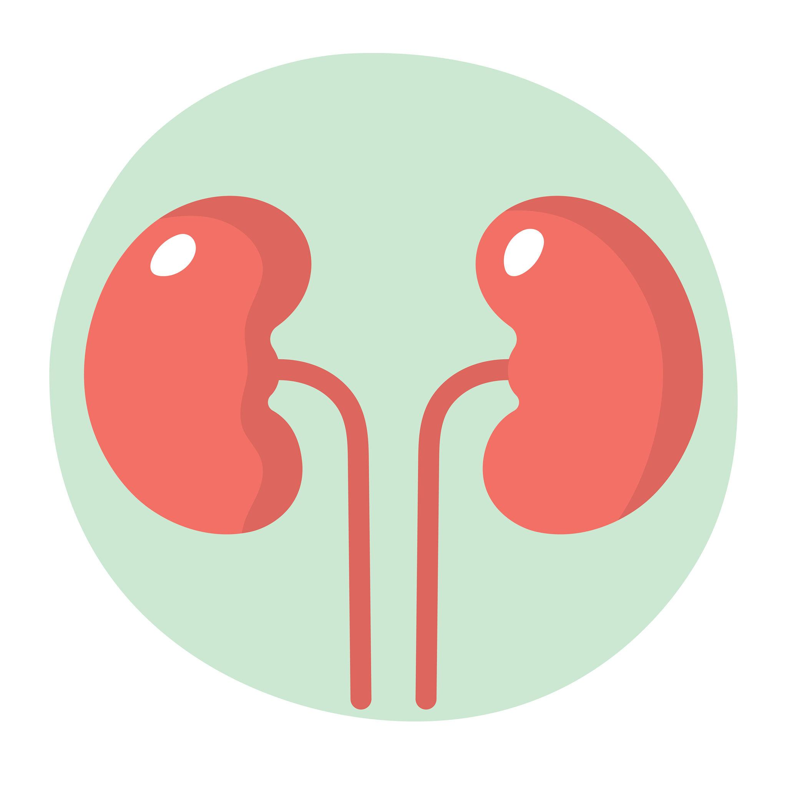

# Doença Renal Crônica

## O que é?

A Doença Renal Crônica (DRC) acontece quando os rins apresentam alterações na estrutura ou na função por um período igual ou superior a três meses.

Os rins são responsáveis por filtrar o sangue, eliminar resíduos e excesso de líquidos e ajudar a controlar substâncias importantes para o funcionamento do organismo.

Quando perdem parte dessa capacidade, algumas substâncias podem se acumular no corpo, exigindo acompanhamento médico e cuidados específicos.

## Alimentos que exigem atenção

Na doença renal crônica, alguns nutrientes podem precisar de controle. Isso depende do estágio da doença, dos exames, da presença de outras condições de saúde e da realização ou não de diálise.

Alguns exemplos de alimentos que podem exigir atenção:

- **Alimentos ricos em sódio:** embutidos, temperos prontos, macarrão instantâneo, salgadinhos e alimentos muito industrializados.
- **Alimentos ricos em potássio:** banana, laranja, abacate, tomate e batata podem precisar de controle em algumas situações.
- **Alimentos ricos em fósforo:** refrigerantes à base de cola, produtos industrializados com aditivos fosfatados e alguns alimentos ricos em fósforo.
- **Alimentos ricos em proteínas:** carnes, ovos, leite e derivados podem precisar de ajustes na quantidade consumida.

**Importante:** esses alimentos não são proibidos para todas as pessoas com doença renal. A necessidade de limitar cada nutriente deve ser avaliada individualmente.

## Alimentos que podem fazer parte da alimentação

Uma alimentação variada e equilibrada pode contribuir para o cuidado com a saúde renal.

Dependendo da avaliação nutricional e dos exames, podem fazer parte da alimentação:

- Frutas e vegetais em quantidades adequadas.
- Arroz, massas e outros cereais.
- Leguminosas, como feijão e lentilha.
- Carnes, ovos e outras fontes de proteína.
- Alimentos preparados em casa, com menor quantidade de sal e produtos industrializados.

A escolha e a quantidade dos alimentos devem considerar as necessidades de cada pessoa.

## Cuidados importantes com a alimentação

- Reduzir o consumo de alimentos muito industrializados, especialmente os ricos em sódio.
- Evitar o uso excessivo de sal e temperos prontos.
- Não utilizar substitutos do sal sem orientação, pois alguns contêm potássio.
- Não aumentar nem reduzir o consumo de proteínas por conta própria.
- Não restringir frutas, verduras ou outros alimentos sem orientação profissional.
- Seguir as orientações sobre consumo de líquidos, quando houver necessidade de controle.
- Manter acompanhamento com médico e nutricionista.

## Atenção!

A alimentação de uma pessoa com doença renal crônica precisa ser individualizada. Restringir potássio, fósforo, proteínas, sódio ou líquidos sem necessidade pode prejudicar a saúde.

As necessidades também podem mudar conforme a evolução da doença e a realização de tratamentos como a hemodiálise.

**Este conteúdo é informativo e não substitui a avaliação de um profissional de saúde.**

## Fontes de informação

1. Ministério da Saúde — Doenças Renais Crônicas (DRC):  
   https://www.gov.br/saude/pt-br/assuntos/saude-de-a-a-z/d/drc

2. Ministério da Saúde — Protocolo Clínico e Diretrizes Terapêuticas para estratégias de atenção à doença renal crônica:  
   https://www.gov.br/saude/pt-br/assuntos/pcdt/e/estrategias-para-atenuar-a-progressao-da-doenca-renal-cronica/view

3. KDIGO — Diretriz internacional para avaliação e manejo da doença renal crônica (2024):  
   https://doi.org/10.1016/j.kint.2023.10.016