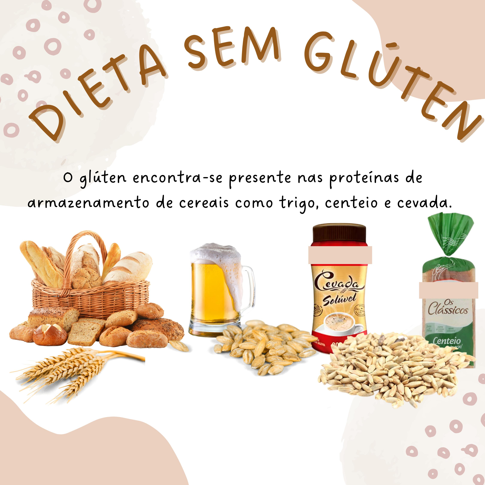
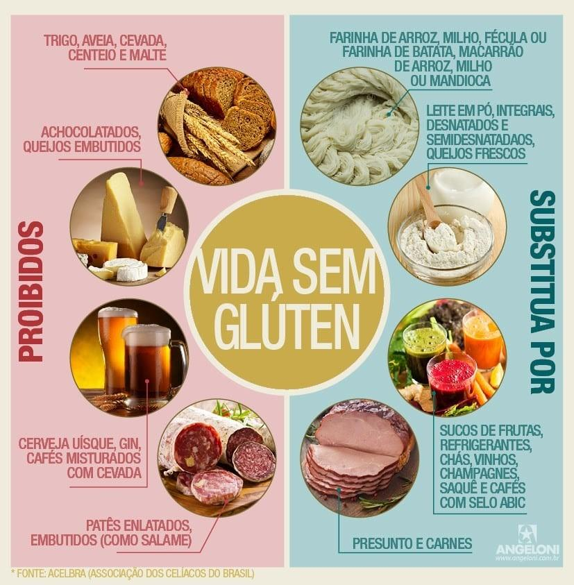
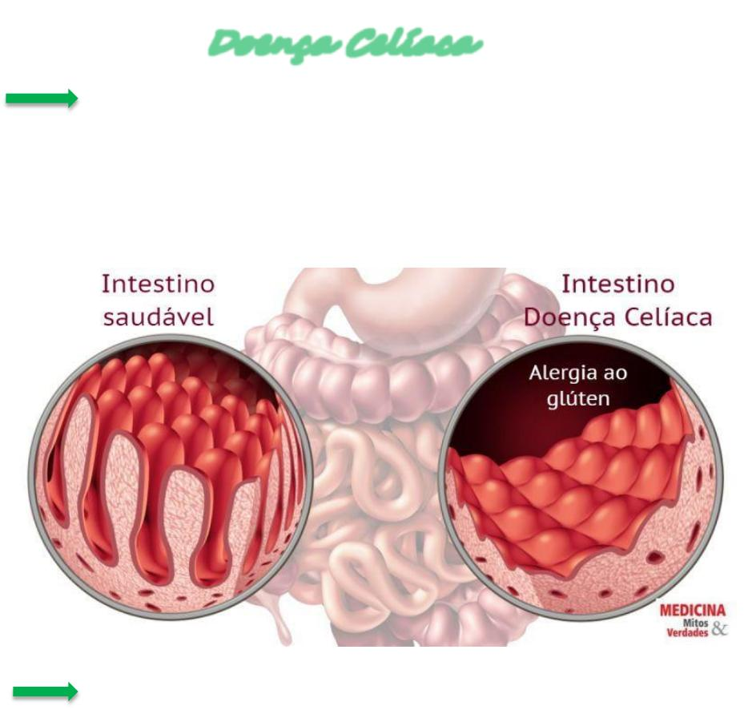

# Doença Celíaca

## O que é?

A doença celíaca é uma condição autoimune permanente desencadeada pela ingestão de glúten em pessoas com predisposição genética.

O glúten é uma proteína encontrada principalmente no trigo, no centeio e na cevada. A aveia também exige atenção, pois pode sofrer contaminação durante o processamento.

Quando uma pessoa celíaca consome glúten, seu sistema imunológico reage e provoca uma inflamação no intestino delgado. Isso pode prejudicar a absorção de nutrientes importantes para o organismo.

## Alimentos que contêm glúten

Pessoas com doença celíaca precisam excluir completamente o glúten da alimentação.

Alguns alimentos que normalmente contêm essa proteína são:

- Pães e torradas feitos com farinha de trigo.
- Bolos, biscoitos e bolachas convencionais.
- Macarrão e massas feitas com trigo.
- Pizzas e salgados preparados com farinha de trigo.
- Produtos que contenham cevada ou centeio.
- Alguns alimentos industrializados que utilizam ingredientes derivados desses cereais.

Atenção: é importante verificar os rótulos dos produtos, pois o glúten também pode estar presente em alimentos nos quais sua presença não é tão evidente.

## Alimentos que podem fazer parte da alimentação

Existem diversas opções naturalmente livres de glúten que podem fazer parte de uma alimentação equilibrada:

- Arroz e milho.
- Mandioca, batata e inhame.
- Frutas e verduras.
- Carnes, peixes e ovos sem ingredientes adicionados com glúten.
- Feijão, lentilha e outras leguminosas.
- Farinha de arroz, farinha de milho e polvilho.
- Produtos industrializados identificados como sem glúten, após conferência do rótulo.

A aveia deve ser escolhida com cuidado, dando preferência a produtos certificados ou identificados como sem glúten e seguindo a orientação profissional.

## Cuidados importantes com a alimentação

- Ler os rótulos dos alimentos antes de consumir.
- Observar as informações "CONTÉM GLÚTEN" e "NÃO CONTÉM GLÚTEN".
- Evitar a contaminação cruzada durante o preparo das refeições.
- Utilizar utensílios e superfícies limpos para preparar alimentos sem glúten.
- Ter cuidado com torradeiras, tábuas, utensílios e óleo de fritura compartilhados.
- Verificar a composição de medicamentos e suplementos com um profissional de saúde.
- Buscar acompanhamento com nutricionista para manter uma alimentação variada e equilibrada.

## Atenção!

O tratamento da doença celíaca consiste na exclusão completa do glúten por toda a vida, após a confirmação do diagnóstico.

**Não é recomendado retirar o glúten da alimentação antes da investigação médica**, pois isso pode interferir nos exames e dificultar a confirmação da doença.

A intolerância ao glúten, a sensibilidade ao glúten e a doença celíaca não são a mesma condição e precisam ser diferenciadas.

**Este conteúdo é informativo e não substitui a avaliação de um profissional de saúde.**

## Fontes de informação

1. Ministério da Saúde — Protocolo Clínico e Diretrizes Terapêuticas da Doença Celíaca (2025):  
https://www.gov.br/saude/pt-br/assuntos/pcdt/d/doenca-celiaca/view

2. Sociedade Brasileira de Pediatria — Doença Celíaca (2025):  
https://www.sbp.com.br/pediatria-para-familias/doencas/doenca-celiaca/

3. Biblioteca Virtual em Saúde — Ministério da Saúde:  
https://bvsms.saude.gov.br/doenca-celiaca/