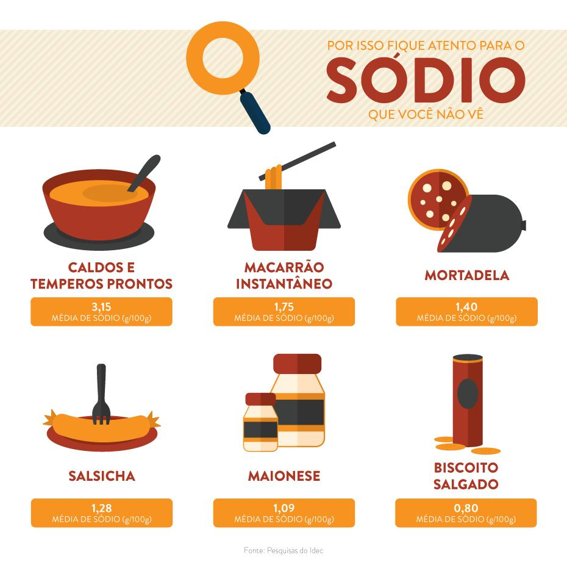
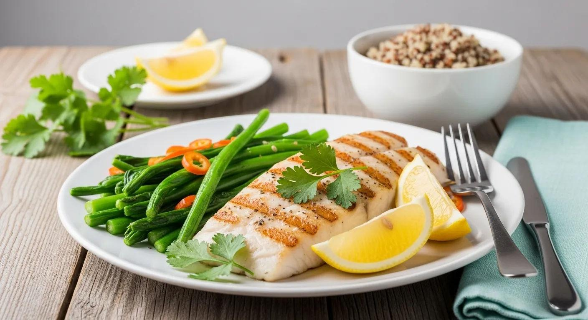
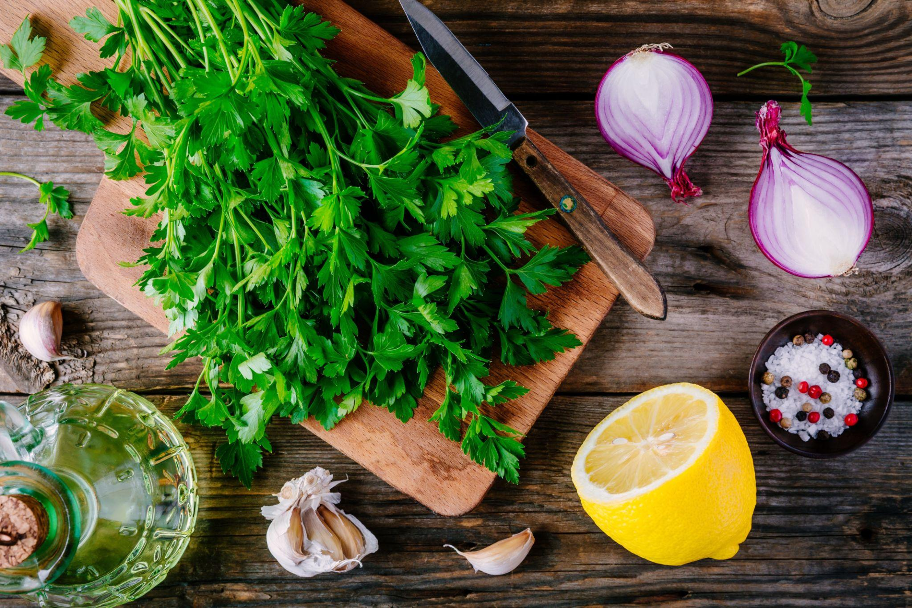

# Hipercalemia

## O que é?

A hipercalemia é uma condição caracterizada pelo aumento da concentração de potássio no sangue.

O potássio é um mineral essencial para o funcionamento dos músculos, dos nervos e do coração. Entretanto, quando seus níveis ficam elevados, podem ocorrer alterações no funcionamento do organismo.

Uma das causas mais comuns é a dificuldade dos rins em eliminar o excesso de potássio.

## Principais causas

A hipercalemia pode estar relacionada a diferentes fatores, como:

- Doença renal crônica;
- Alterações no funcionamento dos rins;
- Uso de determinados medicamentos;
- Consumo excessivo de suplementos de potássio;
- Uso de substitutos do sal que contêm cloreto de potássio;
- Algumas condições metabólicas e hormonais.

## Principais sintomas

Muitas pessoas não apresentam sintomas, especialmente nos casos leves.

Quando aparecem, os sinais podem incluir:

- Fraqueza muscular;
- Cansaço;
- Formigamento;
- Náuseas;
- Sensação de palpitações;
- Alterações no ritmo dos batimentos cardíacos.

Em situações graves, a hipercalemia pode provocar alterações cardíacas perigosas e exige atendimento médico imediato.

## Alimentos que podem exigir atenção

O potássio está presente naturalmente em muitos alimentos. Quando existe necessidade de controlar sua ingestão, alguns alimentos podem precisar de ajuste nas porções ou na frequência de consumo:

- Banana;
- Abacate;
- Mamão;
- Água de coco;
- Frutas secas, como uva-passa e damasco;
- Batata e batata-doce;
- Tomate;
- Espinafre;
- Feijão, lentilha e grão-de-bico;
- Castanhas e outras oleaginosas;
- Leite e derivados.

Também é importante observar produtos industrializados que utilizam cloreto de potássio como ingrediente.

**Atenção:** esses alimentos não são proibidos para todas as pessoas com hipercalemia. A necessidade de limitar cada alimento depende dos exames e da orientação profissional.

## Alimentos que podem fazer parte da alimentação

Quando existe indicação de uma alimentação com menor teor de potássio, algumas opções podem ser consideradas:

- Maçã;
- Pera;
- Morango;
- Abacaxi;
- Uva;
- Melancia;
- Alface;
- Pepino;
- Repolho;
- Cenoura;
- Arroz;
- Macarrão;
- Pães.

A quantidade consumida e a combinação dos alimentos também influenciam a ingestão total de potássio.

## Cuidados importantes

- Não utilizar suplementos de potássio sem orientação profissional;
- Evitar substitutos do sal sem verificar sua composição;
- Observar os rótulos dos alimentos industrializados;
- Seguir as orientações sobre porções e preparo dos alimentos;
- Realizar os exames solicitados para acompanhar os níveis de potássio;
- Não interromper medicamentos por conta própria;
- Manter acompanhamento médico e nutricional.

Em algumas situações, o cozimento de determinados vegetais em água e o descarte dessa água podem reduzir parte do potássio presente no alimento. Esse método deve ser utilizado conforme orientação nutricional.

## O que é importante saber?

A hipercalemia não significa que todas as frutas, verduras e leguminosas precisam ser retiradas da alimentação.

O potássio é necessário para o organismo, e sua restrição excessiva também pode trazer prejuízos.

A alimentação deve considerar os resultados dos exames, o funcionamento dos rins, os medicamentos utilizados e as necessidades nutricionais de cada pessoa.

O tratamento pode envolver ajustes alimentares, revisão de medicamentos e outras medidas médicas. A alimentação isoladamente nem sempre é suficiente para controlar a condição.

## Referências

- Ministério da Saúde — Lista de alimentos ricos e pobres em potássio.  
  https://linhasdecuidado.saude.gov.br/portal/doenca-renal-cronica-%28DRC%29-em-adultos/listagem-alimentos/

- National Institutes of Health (NIH) — Potassium: Health Professional Fact Sheet.  
  https://ods.od.nih.gov/factsheets/Potassium-HealthProfessional/

- National Kidney Foundation — High Potassium (Hyperkalemia).  
  https://www.kidney.org/kidney-topics/hyperkalemia-high-potassium

- National Institute of Diabetes and Digestive and Kidney Diseases (NIDDK) — Healthy Eating for Adults with Chronic Kidney Disease.  
  https://www.niddk.nih.gov/health-information/kidney-disease/chronic-kidney-disease-ckd/healthy-eating-adults-chronic-kidney-disease

---

*Conteúdo educativo. Não substitui avaliação, diagnóstico ou orientação de profissionais de saúde.*